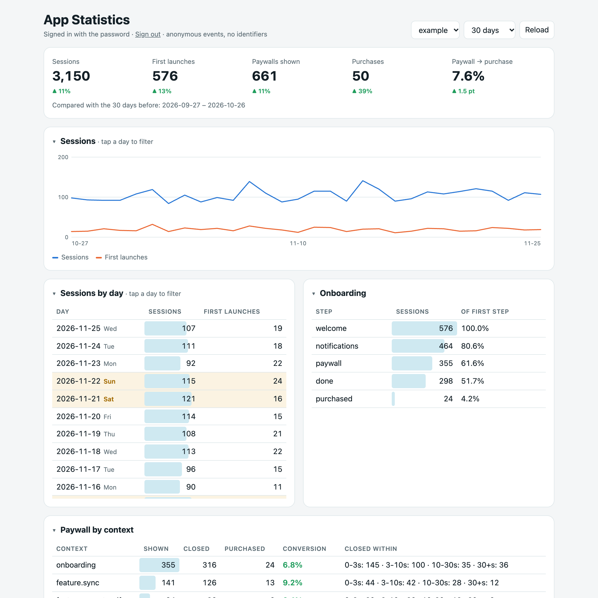
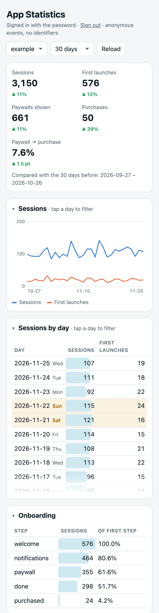

# skoro-stats

Self-hosted, privacy-first usage statistics for iOS and Android apps, on Cloudflare's free
plan. You get counts such as "paywall shown" or "export failed", never what's in them. There
are no user IDs, no IP addresses and no device fingerprints.

- **No server to run, nothing to pay:** two Cloudflare Workers and one D1 database, sized to
  fit the free plan.
- **Allowlisted events:** each app has a schema of the events, properties and values it may
  send, and anything else is dropped at ingest. An app can't send personal data even by mistake.
- **Built for apps:** onboarding funnels, paywalls, purchases, version adoption, days since
  install, and panels for each app's own events.

Made by the developer of Code Viewer.



<sub>Made-up numbers from `npm run demo`.</sub>

| Folder | What |
|---|---|
| `Package.swift`, `Sources/SkoroStats` | the Swift package (iOS 16+) |
| `android/` | the Kotlin client (a JVM library with no Android dependencies) |
| `server/` | the ingest Worker, the dashboard Worker, the migrations |
| `server/config.example/` | a template for your apps and your Cloudflare setup |

## Quickstart (about 5 minutes)

You need Node 22.5 or newer and a Cloudflare account (the free plan is enough).

```sh
git clone https://github.com/skoroapps-hq/skoro-stats && cd skoro-stats/server
npm install
npx wrangler login
npm run setup
```

`npm run setup` copies `config.example/` to `config/` (git-ignored: it's yours), creates the
D1 database, applies the migrations, makes a key for each app, deploys both Workers and sets a
dashboard password. At the end it prints the endpoint, the dashboard URL, the keys and the
password. The password and the keys are printed only once. Run it again any time: it skips
whatever is already set up. If your login sees several accounts, pick one with
`CLOUDFLARE_ACCOUNT_ID=<id> npm run setup`.

Then describe your own apps in `config/apps.js` and `config/schemas/` (next section), and
deploy with `npm run deploy`.

## Your apps

`server/config/apps.js` lists your apps. Each app has:

- `schema`: the events it may send, with each property's allowed values. The common events
  (`server/schemas/common.json`: first run, onboarding steps, paywalls, purchases, restores,
  locked features, review prompts, session start) are included. An app's own schema adds
  events, or narrows a common one by name.
- `onboarding` (optional): the onboarding steps in funnel order.
- `panels`: the app's own dashboard sections, of three types:
  - `values`: how often each value of a property occurs.
  - `counts`: how often each event in a list occurs.
  - `flags`: for `"0"`/`"1"` properties, how often each is `"1"`.

The comments in `config.example/apps.js` describe every option.

```json
{
  "export": { "format": ["pdf", "markdown", "text"], "outcome": ["done", "failed", "cancelled"] }
}
```

A value is either one from the list, or, with `"*"`, any short token (`^[A-Za-z0-9_.]{1,64}$`)
such as a feature name from your code. Free text never fits, so it can't leak.

### Adding an app

1. Add its schema and its entry in `config/apps.js`. `npm test` checks your config: panels
   may only read allowed events, and every view must fit the free plan.
2. Give it a key. `APP_KEYS` is one secret holding every app's key, so put the whole map:
   ```sh
   printf '{"notes":"<key>","otherapp":"<key>"}' | npx wrangler secret put APP_KEYS -c config/wrangler.toml
   ```
   A key is any random string, for example from `openssl rand -hex 16`.
3. `npm run deploy`. Do this **before** shipping the app, because the server refuses apps it
   doesn't know.

Shipped app versions keep sending what they were built with, so only ever add events and
values. Never take them away.

### Keeping your config in git

`config/` is ignored by this repository. To keep it under version control, make it a
repository of its own: `cd server/config && git init`, then push it to a private remote.

## In the app

Swift Package Manager: `https://github.com/skoroapps-hq/skoro-stats`, from `2.0.2`.

```swift
import SkoroStats

final class AppStats: StatsCollector {
    func exported(_ format: String, _ outcome: String) { send("export", ["format": format, "outcome": outcome]) }
}

let stats = AppStats(enabled: { settings.sharesStatistics })
// At launch: the dashboard's "days since install". Your own launch facts go in the second
// argument, listed (with `days`) under the app's own `session_start` in its schema.
stats.sessionStart(daysSinceInstall: daysSinceInstall, ["notes": "6-20"])
#if !DEBUG
stats.transport = HTTPStatsTransport(app: "notes", key: "<its key>",
                                     endpoint: URL(string: "https://<your ingest Worker>/v1/events")!,
                                     tier: { store.isPro ? .pro : .free })
#endif
// When the scene goes to the background:
stats.flush()
```

Leave out `tier:` for an app with nothing to buy. The package ships a privacy manifest (no
tracking; product interaction, not linked to the user, used for analytics). Still mention
these statistics in your privacy policy and your App Store privacy answers.

Android, from Maven Central (`implementation("com.skoroapps:skoro-stats:2.0.2")`), with the same
events and buckets:

```kotlin
val stats = AppStats(enabled = { settings.sharesStatistics })   // : StatsCollector
stats.transport = HttpStatsTransport(
    app = "notes", key = BuildConfig.STATS_KEY, endpoint = "https://<your ingest Worker>/v1/events",
    version = versionName, build = versionCode.toString(), os = Build.VERSION.RELEASE.substringBefore('.'),
    language = { Locale.getDefault().language.ifEmpty { "und" } },
    device = { if (resources.configuration.smallestScreenWidthDp >= 600) HttpStatsTransport.TABLET else HttpStatsTransport.PHONE },
    tier = { if (isPremium) StatsTier.Pro else StatsTier.Free },
)
// When the app goes to the background:
stats.flush()
```

Events are kept in memory and sent in batches. A send that fails is dropped, and nothing is
written to disk: that is a privacy choice.

**From 1.x to 2.0** (both clients): the endpoint has no default any more, so pass it; the
paid state is a `StatsTier` (`.pro`, `StatsTier.Pro`) instead of a string. What goes over the
wire hasn't changed.

## Privacy, in plain words

Each event stores: when it arrived, the app, its version and build, the major OS version, the
language, the country (two letters, from Cloudflare), the device type (phone or tablet), the
paid state, a session id, and the event's name and allowed properties.

- **The session id** is random for each launch and never saved on the device, so events can't
  be tied to a person or to a device across launches.
- **The IP address** is used only by the rate limiter (30 requests per 10 seconds) and isn't
  stored anywhere.
- **Anything not in the app's schema** (an unknown event, property or value) is dropped before
  it's stored.
- **Events older than 13 months** are deleted by a daily job.

## The dashboard and its login

The dashboard shows all apps side by side, or one app with a sessions chart, change against
the period before, the onboarding funnel, paywalls, purchases, version adoption, days since
install, breakdowns by version, OS, device, country and paid state, and the app's own panels.
Clicking a day or a value filters every section. It works on a phone too, and until the
first event arrives it shows how to send a test event.



To try it without a Cloudflare account, run `npm run demo` in `server/` and open
http://localhost:8787. It shows 90 days of made-up data for two apps (`EMPTY=1 npm run demo` shows a fresh install).

There are two ways to sign in:

- **Password** (what `npm run setup` sets): one shared password, the `DASHBOARD_PASSWORD`
  secret, at least 12 characters. A signed cookie keeps you signed in for 30 days. Login
  tries are rate limited, and changing the password signs everyone out:
  `npx wrangler secret put DASHBOARD_PASSWORD -c config/wrangler.dashboard.toml`.
- **Cloudflare Access** (Zero Trust, free for up to 50 users; sign in with an email code, Google
  or GitHub):
  1. Workers & Pages › `skoro-stats-dashboard` › Settings › Domains & Routes › `workers.dev`
     › **Enable Cloudflare Access**. The first time, it asks you to set up Zero Trust.
  2. Zero Trust › Access › Applications › the new application › Policies: allow your email.
     Overview shows the **Application Audience (AUD) tag**.
  3. Put the team domain (`<team>.cloudflareaccess.com`) and the AUD tag into
     `config/wrangler.dashboard.toml` (`TEAM_DOMAIN`, `ACCESS_AUD`) and run `npm run deploy`.
     While Access is set, the password is ignored. The Worker checks the Access token
     itself, so the dashboard stays closed if Access is switched off by mistake.

## Free-plan limits

| D1 free plan | What skoro-stats does |
|---|---|
| 50 queries per request | 3 per dashboard view; a test fails past 45 |
| 5 million rows read a day | a 30-day view of an app with ~1,500 sessions a month reads ~8,000 rows |
| 100,000 rows written a day | 2 per event (the row and its one index), plus 1 per batch for the session |
| 5 GB of storage | events older than 13 months are deleted |

The dashboard keeps each answer for 5 minutes (Reload asks for fresh numbers). Check the usage
with `npx wrangler d1 insights skoro-stats --sort-by reads -c config/wrangler.toml`.

### How the data is laid out

All apps share **one `events` table**, and a `sessions` table with one row per session and
day. The `sessions` table lets the dashboard count sessions without reading every event in the
period. Each view makes three plain reads (the period's sessions, the events it shows by name,
and the paywall events of the period before) and works out the rest in JavaScript. A `GROUP
BY` would cost a second read of every row, because D1 counts the sort. A test checks every
dashboard query's plan, so no query reads a whole table.

Adding an app or an event needs no migration: what's specific to an app lives in the `props`
JSON of each event. Add a column only for something every app has.

## Updating

```sh
git pull && cd server && npm install && npm test && npm run deploy
```

`npm run deploy` applies any new migration in `server/migrations/` first, then deploys both
Workers. Migrations only ever add, so app versions that are already shipped keep working.

## The request

```
POST /v1/events
X-Stats-Key: <the app's key>
{"app":"notes","v":"3.0","build":"3.0.0","os":"18","lang":"en","pro":"free","device":"iphone",
 "session":"<uuid>","events":[{"n":"paywall_shown","p":{"context":"onboarding"},"t":1200}]}
```

| Status | Meaning |
|---|---|
| 204 | taken |
| 400 | malformed |
| 401 | wrong key |
| 413 | over 16 KB |
| 429 | too many requests |

A request carries at most 50 events. `GET /health` answers `{"ok":true,"configured":true}`
once `APP_KEYS` is set.

## Development

- **Dashboard UI:** `npm run demo` (above) serves the real page and API with made-up data;
  reload the browser after editing `server/src/page.js` and restarting it.
- **Server:** `cd server && npm test` (Node 22.5+; D1 is `node:sqlite`). The tests run against
  the apps in `server/test/apps.js`. They also check `config.example/`, and your `config/` when
  it's there.
- **Swift:** `swift test` from the root.
- **Kotlin:** `./gradlew test` in `android/` (any Gradle 9).

Both clients' tests check their common events against `server/schemas/common.json`. See
[CONTRIBUTING.md](CONTRIBUTING.md).

## License

[MIT](LICENSE)
